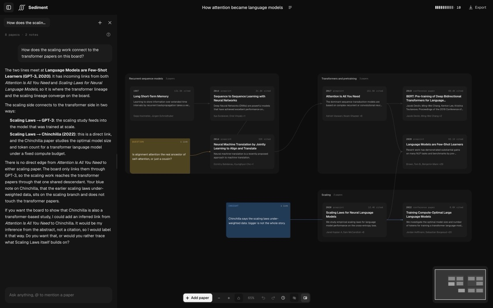
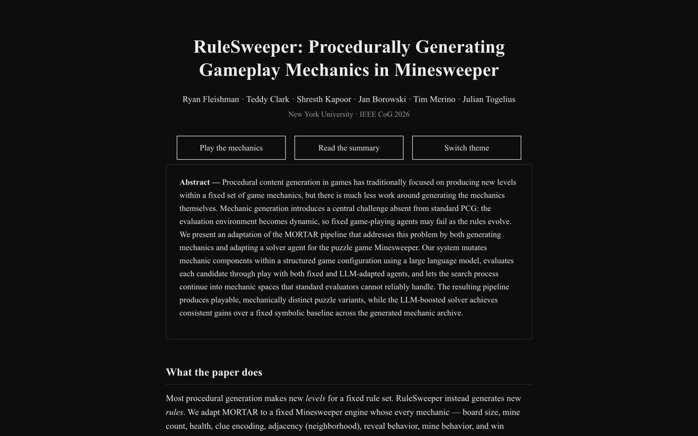
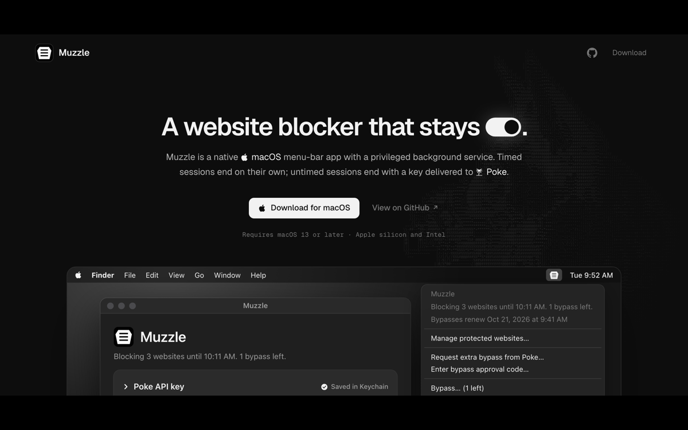
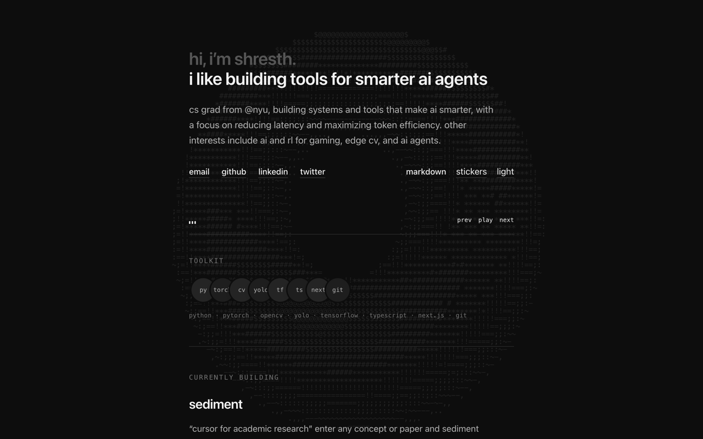

  

<table>
  <tr>
    <td width="50%" valign="top">
      <code>01</code> <b>sediment</b> · <a href="https://www.sediment-ai.com/">sediment-ai.com</a> 
       
      a canvas for research, with an agent beside you
    </td>
    <td width="50%" valign="top">
      <code>02</code> <b>rulesweeper</b> · ieee cog 2026 
       
      llm-guided evolution of minesweeper mechanics
    </td>
  </tr>
  <tr>
    <td width="50%" valign="top">
      <code>03</code> <b>muzzle</b> · macos 
       
      native menu-bar website blocker with a privileged daemon
    </td>
    <td width="50%" valign="top">
      <code>04</code> <b>space</b> · <a href="https://shresth.space">shresth.space</a> 
       
      portfolio, research and writing
    </td>
  </tr>
</table>

  <a href="https://shresth.space"><code>shresth.space ↗</code></a>
  &nbsp;
  <a href="https://x.com/rested_7"><code>x ↗</code></a>
  &nbsp;
  <a href="https://www.linkedin.com/in/shresth-kapoor-7skp"><code>linkedin ↗</code></a>

